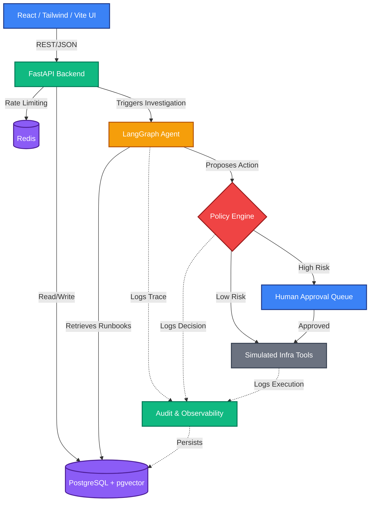

# OpsPilot

**OpsPilot is an enterprise AI WorkOps platform that investigates incidents using RAG and AI agents while enforcing policy, human approval, observability, and auditability.**

 *(Note: Replace with actual screenshot)*

OpsPilot bridges the gap between raw LLM capabilities and strict enterprise compliance. It safely brings autonomous AI agents into the IT operations workflow by wrapping them in a deterministic policy engine, requiring human-in-the-loop approvals for high-risk actions, and maintaining an immutable audit log of every decision.

---

## 🌟 Key Features

*   **LangGraph Agent with Structured Output:** Complex, multi-step incident investigations driven by a stateful agent graph that strictly outputs schema-validated responses, eliminating hallucinated formatting.
*   **Grounded RAG with pgvector:** Retrieval-Augmented Generation that isolates tenant data via row-level security and strict organizational scoping, ensuring agents only reason over authorized runbooks and documentation.
*   **Deterministic Policy Engine:** An impenetrable rule layer that evaluates every AI proposal. Actions classified as high-risk are automatically blocked pending human review.
*   **Human-in-the-Loop Approvals:** A unified queue where human administrators can review, approve, or reject high-risk AI proposals before any destructive infrastructure changes are executed.
*   **Rule-Based AI Evaluation:** Automated metric tracking (e.g., groundedness, retrieval relevance, confidence sanity) applied to every agent run to continuously monitor AI performance.
*   **FinOps Cost Tracking:** Real-time token usage and cost calculation embedded directly into the observability pipeline.
*   **Immutable Audit Log:** Every action—whether performed by a human or an AI agent—is cryptographically verifiable and logged for compliance (SOC2/ISO27001 readiness).

---

## 🏗 Architecture

OpsPilot is built on a modern, scalable stack designed for enterprise deployment.



### Technology Stack
*   **Frontend:** React 18, TypeScript, TailwindCSS, Zustand, React Router, Vite.
*   **Backend:** FastAPI, Python 3.11, SQLAlchemy (Async), Pydantic v2.
*   **AI/Agent:** LangGraph, LangChain Core, OpenAI API (or Mock Providers).
*   **Database & Cache:** PostgreSQL 16, pgvector, Redis.
*   **Infrastructure:** Docker Compose, Pytest.

---

## 🚀 Getting Started

OpsPilot is fully containerized. To spin up the entire stack locally with seeded demo data:

### Prerequisites
*   [Docker](https://docs.docker.com/get-docker/) and Docker Compose
*   (Optional) OpenAI API Key for live LLM mode

### 1. Clone the Repository
```bash
git clone https://github.com/your-org/opspilot.git
cd opspilot
```

### 2. Start the Infrastructure
```bash
docker compose up -d
```
*This command starts the PostgreSQL database, Redis, FastAPI backend, and Vite frontend.*

### 3. Verify
Run the integration test suite to ensure the environment is healthy:
```bash
docker compose exec backend pytest -v
```

### 4. Access the Application
Navigate to `http://localhost:5173` in your browser.
*   **Email:** `admin@demo-corp.com`
*   **Password:** `admin123`

---

## 🛠 Directory Structure

```text
opspilot/
├── backend/
│   ├── app/
│   │   ├── api/          # FastAPI routing and schemas
│   │   ├── core/         # Security, configuration, and deps
│   │   ├── db/           # SQLAlchemy models and migrations
│   │   ├── services/     # Business logic (Tickets, Audits, etc.)
│   │   └── ai/           # LangGraph Agent, RAG, and Evaluators
│   ├── tests/            # Pytest integration and unit tests
│   └── scripts/          # Database seeding scripts
├── frontend/
│   ├── src/
│   │   ├── components/   # UI components and layout
│   │   ├── pages/        # Route views (Dashboard, Tickets, etc.)
│   │   ├── api/          # Axios HTTP clients
│   │   └── stores/       # Zustand state management
│   └── index.html        # Entry point
└── docker-compose.yml    # Main infrastructure configuration
```

---

## 🔒 Security & Compliance
*   **Row-Level Tenant Isolation:** Every request is strictly scoped to the `org_id` of the authenticated user.
*   **Rate Limiting:** Global rate limiting powered by Redis to mitigate abuse.
*   **Secret Management:** No API keys are stored in the database. 
*   **Simulated Tools:** By default, infrastructure tools run in a safe, simulated environment to prevent accidental destructive actions during testing.

---

*OpsPilot — Because enterprise AI doesn't mean moving fast and breaking production.*
